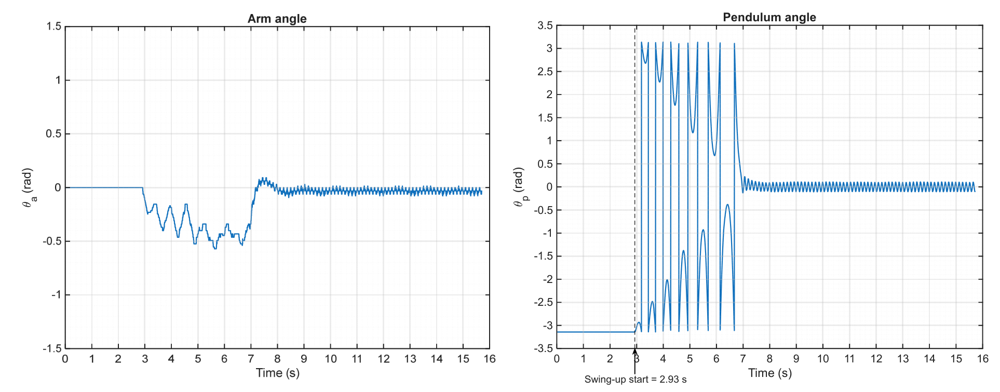
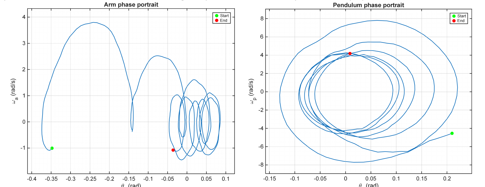
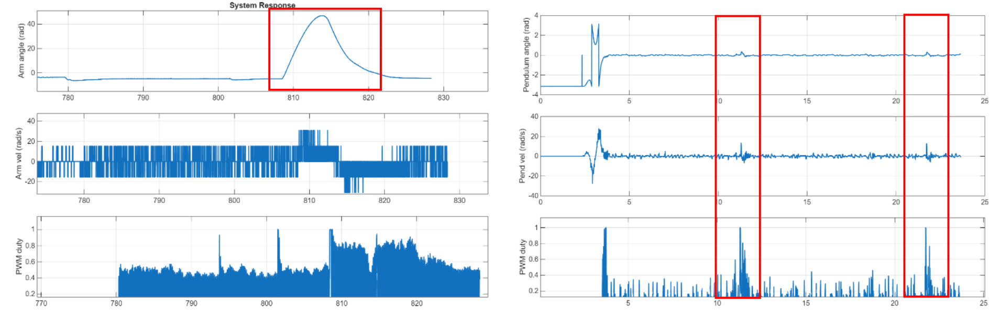

# 2-DOF Furuta 旋转倒立摆（Rotary Inverted Pendulum）

[English](README.md) | 中文说明

**Design, Build, and Test of a Non-Linear Dynamic System** —— 布里斯托大学（University of Bristol）电气、电子与机械工程学院机电一体化毕业设计项目（Group G2025，2025–2026）。

本仓库完整归档了支持**自主起摆与直立稳摆**的 2-DOF Furuta 旋转倒立摆实验平台的 STM32 嵌入式固件、MATLAB/Simulink 仿真模型、机械 CAD 图纸、电气接线与 BOM 文档、实机实验数据及最终毕业论文。

---

## 核心亮点

- **完整硬件实验平台**：定制加工的旋臂与摆杆结构、支持 360° 连续无限旋转的导电滑环、双正交编码器、12 V 直流减速电机驱动及运行在 **1 kHz** 实时控制周期下的 **STM32 Nucleo-F446RE** 嵌入式控制器。
- **自主起摆控制**：基于反馈线性化与 Lyapunov 能量控制的起摆算法（`furuta_swingup.c`），配合平滑切换逻辑进入直立稳摆区。
- **两种直立稳摆控制策略对比**：
  1. **双闭环串级 PID 基线方案**（`firmware/swingup_pid/`、`simulation/pid_swingup/`）：带微分滤波的工程实用基线控制器。
  2. **离散时间 LQR 与增益调度 Soft-LQR**（`firmware/swingup_lqr/`、`firmware/swingup_soft_lqr/`）：基于机电联合线性化状态空间模型与零阶保持离散化（`c2d`, $T_s = 1\text{ ms}$），结合控制输出一阶低通滤波与分区增益调度 **Soft-LQR**（`K_inner` / `K_mid` / `K_outer`），有效抑制编码器量化噪声和环路延迟引发的高频抖振与极限环振荡。
- **Sim-to-Real 高保真闭环验证**：Simulink 仿真模型中引入了电机反电动势阻尼、粘滞/库伦摩擦、编码器量化、零阶保持及死区特性，并与实物平台 `.csv` 遥测日志完成时域与频域对齐验证。

---

## 仓库目录结构

```text
├── README.md
├── README_CN.md
├── LICENSE
├── docs/
│   ├── Final_Report_G2025.pdf          # 完整毕业设计最终论文（PDF）
│   ├── LQR_Presentation.pptx           # 控制策略设计答辩演示文稿
│   ├── system_parameters.md            # 物理与电机参数汇总表
│   └── notes/                          # 技术笔记（英文主文档 + `_CN.md` 中文对照）
├── firmware/                           # STM32CubeIDE C 工程（STM32F446RE）
│   ├── swingup_lqr/                    # 起摆 + 一阶低通滤波离散 LQR
│   ├── swingup_soft_lqr/               # 起摆 + 一阶低通滤波增益调度 Soft-LQR
│   └── swingup_pid/                    # 起摆 + 串级 PID 控制器
├── simulation/                         # MATLAB & Simulink 仿真模型
│   ├── lqr_ideal_real/                 # 理想与真实约束下的 LQR 仿真及三维动画
│   ├── lqr_first_order_filter/         # 离散 LQR（`Discrete_of_init_LQR.m`）与滤波模型
│   ├── lqr_kalman_filter/              # 基于卡尔曼状态观测器的 LQR 仿真（`Model_LQR_Real_Kalman.slx`）
│   └── pid_swingup/                    # Furuta 基础动力学模型及串级 PID / 起摆仿真
├── hardware/
│   ├── cad/                            # SolidWorks 零件（`.SLDPRT`）与激光切割图纸（`.DXF`）
│   └── electrical/                     # 物料清单、引脚定义与接线说明（英文 + `_CN.md` 对照）
├── experiments/
│   ├── data/                           # 实机平台采集日志（`.csv`）
│   ├── scripts/                        # MATLAB 后处理脚本（`Graphs.m`、`Phase.m`、`delay.m` 等）
│   └── figures/                        # PID/LQR 实机曲线、相轨迹、Bode 图与抗扰对比图
└── media/
    └── demo_video.mp4                  # 实机演示视频原始文件
```

---

## 实验结果与控制器对比

所有子系统的完整图表与理论推导见 [`docs/Final_Report_G2025.pdf`](docs/Final_Report_G2025.pdf) 第 6 章。

### 1. 自主起摆与模式切换（报告 6.1–6.2 节）

- **自主起摆**：采用反馈线性化 + Lyapunov 能量控制（经 `tanh` 平滑与 $\alpha = 0.9$ 一阶速度滤波），实物起摆仅比仿真慢 **0.188 s** 且电机无明显抖振；在不使用旋臂回中 PD 的情况下，依靠固有物理摩擦即可将旋臂摆幅安全限制在 **35.3°** 以内。
- **切换逻辑**：在 $|\dot{\theta}_p| < 5\text{ rad/s}$、$|\dot{\theta}_a| < 5\text{ rad/s}$ 及连续 `10 ms` 消抖确认条件下，对多个角度阈值各测试 20 次：**0.25 rad** 实现了 **100% 切换成功率**（`0.15 rad` 为 85%），同时避免了 `0.35–0.45 rad` 下切换瞬间的执行器饱和问题。

### 2. 稳摆性能对比：串级 PID vs. 离散 LQR（报告 6.3–6.5 节）

| 评价指标 | 串级 PID（`firmware/swingup_pid/`） | 离散 LQR（`firmware/swingup_lqr/`, `R = 20`） |
| :--- | :--- | :--- |
| **控制结构** | 双闭环串级 PD/PID（内环 `1 ms` / 外环 `7 ms`） | 状态反馈 DLQR（`Ts = 1 ms`）+ 级联 LPF（$\alpha_{\text{angle}}=0.9$, $\alpha_{\text{output}}=0.71$） |
| **仿真收敛表现** | 摆杆 `1.26 s`（$\pm 0.01\text{ rad}$），旋臂 `1.29 s`（$\pm 0.02\text{ rad}$） | $R \ge 0.7$ 时理论稳定（+50.7° 相位裕度），可耐受 `50 ms` 12 V 脉冲扰动 |
| **实机捕获与稳态** | `0.54 s` 进入稳态包络；存在约 `7.5 Hz` 残余极限环（`+0.109` 至 `-0.107 rad`，峰峰值 `0.216 rad`）；旋臂稳定在 $\pm 0.05\text{ rad}$ 内 | 有效抑制高频抖振（+48.2° 相位裕度，带宽 `18.4 rad/s`）；稳态极限环幅值更小（图 56 中约 $\pm 0.035\text{ rad}$） |
| **100% PWM 脉冲扰动（`20 / 25 ms`）** | 稳定恢复 | 稳定恢复 |
| **100% PWM 脉冲扰动（`30 ms`）** | 处于临界区（恢复率约 4/10，旋臂需旋转多圈） | 稳定恢复 |
| **100% PWM 脉冲扰动（`40 ms`）** | 失稳倾倒（受限于执行器物理极限） | 失稳倾倒（受限于执行器物理极限） |

### 3. 实验结果图与实机演示视频

| 串级 PID：实机起摆与捕获响应 | 串级 PID：实机相轨迹 |
| :---: | :---: |
|  |  |

| PID vs. LQR：30 ms 100% PWM 脉冲抗扰对比 | LQR vs. Soft-LQR：极限环对比 |
| :---: | :---: |
|  |  |

- [`experiments/figures/`](experiments/figures/) 中的其他代表性图像：
  - [PID 切换瞬态 PWM 与 0.54 s 收敛放大图](experiments/figures/PID_hardware_zoomed_control.png)
  - [LQR 时域滤波延迟实测验证（总延迟 11.6 ms）](experiments/figures/Time-domain%20Delay%20Verification.png)

https://github.com/user-attachments/assets/3cab052c-f99d-4dfd-ab25-deb1932a8f66

- 原始演示视频文件：[`media/demo_video.mp4`](media/demo_video.mp4)
- 完整理论推导、硬件设计与实验评估报告：[`docs/Final_Report_G2025.pdf`](docs/Final_Report_G2025.pdf)

---

## 快速开始

### 1. MATLAB / Simulink 仿真
1. 打开 MATLAB 并进入 `simulation/` 下的对应子目录（例如 `simulation/lqr_first_order_filter/`）。
2. 先运行初始化脚本向工作区加载物理参数与控制器增益：
   - **离散 LQR**：先运行 `Discrete_of_init_LQR.m`（或 `init_LQR.m`），再打开 `Model_LQR_Real_First_order.slx`。
   - **卡尔曼观测器 LQR**：先运行 `init_LQR_Kalman.m`，再打开 `Model_LQR_Real_Kalman.slx`。
   - **PID 与基础动力学模型**：参考 `simulation/pid_swingup/README_base_model.md` 与 `PID_correection_hardware.slx`。

### 2. STM32 固件烧录（STM32CubeIDE）
1. 打开 **STM32CubeIDE**，从 `firmware/` 导入以下任一工程：
   - `firmware/swingup_lqr/` —— 起摆 + 一阶低通滤波离散 LQR
   - `firmware/swingup_soft_lqr/` —— 起摆 + 一阶低通滤波增益调度 Soft-LQR
   - `firmware/swingup_pid/` —— 起摆 + 串级 PID
2. 编译（`Project -> Build Project`）并通过 ST-LINK 烧录至 **Nucleo-F446RE**。
3. 可通过 `USART2` 串口（115200 bps）每 `50 ms` 查看遥测输出；板载蓝色用户按键（`PC13`）支持启动起摆及稳摆中一键急停。

### 3. 机械结构与电气硬件
- 机械零件与激光切割文件位于 `hardware/cad/`。
- 电气 BOM、引脚定义与接线说明位于 [`hardware/electrical/README_CN.md`](hardware/electrical/README_CN.md) 与 [`hardware/electrical/hardware_notes_CN.md`](hardware/electrical/hardware_notes_CN.md)。

---

## 团队分工与致谢

- **项目团队（Group G2025，布里斯托大学）**：
  - **Huaicheng Huang**：机电联合建模、Simulink 仿真、LQR / Soft-LQR 与滤波算法实现
  - **Ruisen He**：串级 PID 控制 Simulink 仿真、系统集成与实机测试
  - **Esther Chiu**：动力学建模、起摆控制 Simulink 仿真、集成与测试
  - **Yingjie Guan**：机械结构设计加工、系统参数辨识与抗扰动实验测试
  - **Janet Ngai**：电气与嵌入式实现、切换逻辑集成测试与 PCB 设计
- **指导教师**：Dr. Andrew Harrison
- **基础动力学模型致谢**：`simulation/pid_swingup/` 中的初始 Furuta 倒立摆状态导数与动画框架改编自开源项目 `furuta-inverted-pendulum` 基础动力学模板（详见 `simulation/pid_swingup/README_base_model.md`），并由本团队针对实物参数、起摆、串级 PID、离散 LQR 及滤波控制进行了完整扩展。
