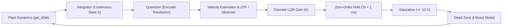

# Sim-to-Real Discretization and Non-Idealities in Simulink

Ideal continuous-time simulations assume infinite sensor resolution, instantaneous actuator updates, and zero dead-zone. To bridge the simulation-to-reality gap for the 1 kHz STM32F446RE hardware rig, four key non-idealities are modeled in Simulink (`simulation/lqr_first_order_filter/`).

---

## 1. Time Discretization: Zero-Order Hold (ZOH)

- **Physical Cause**: The embedded control loop executes at $1\text{ kHz}$ ($T_s = 0.001\text{ s}$). Between sampling instants, the PWM motor command remains constant.
- **Simulink Implementation**: Place a `Zero-Order Hold` block with `Sample time = 0.001` between the controller output and the plant/motor input.
- **Control Design Counterpart**: Discretize the electromechanical state-space system using `c2d(sys_c, T_s, 'zoh')` and synthesize gains via `dlqr(G, H, Q, R)`.

---

## 2. Angular Quantization: Quantizer Blocks

- **Physical Cause**: Quadrature encoders measure discrete pulses rather than continuous angles.
- **Hardware Resolutions (4x Quadrature Decoding on STM32)**:
  - **Pendulum encoder (`TIM3`)**: $4096\text{ counts/rev} \implies \Delta\theta_1 = \frac{2\pi}{4096} \approx 1.534 \times 10^{-3}\text{ rad}$
  - **Rotary arm motor encoder (`TIM1`)**: $44\text{ counts/rev (motor shaft)} \times 9.267\text{ (gear ratio)} \approx 407.75\text{ counts/rev (output)} \implies \Delta\theta_{\text{arm}} = \frac{2\pi}{44 \times 9.267} \approx 1.541 \times 10^{-2}\text{ rad}$
- **Simulink Implementation**: Demux the state vector $S = [\theta_{\text{arm}},\, \dot{\theta}_{\text{arm}},\, \theta_1,\, \dot{\theta}_1]^T$ and apply separate `Quantizer` blocks strictly to the two angle channels ($\theta_{\text{arm}}$ and $\theta_1$). Velocity channels must not be directly quantized; instead, velocities are estimated from quantized angles.

---

## 3. Differentiated Velocity Noise & Filtering

- **Physical Cause**: Encoders provide position only. Direct backward differentiation over $T_s = 1\text{ ms}$ amplifies a single quantization step into large velocity spikes ($\Delta\theta_1 / T_s \approx 1.53\text{ rad/s}$) separated by zeros.
- **Simulink Implementation**: Estimate angular velocities from the quantized angle channels using discrete differentiation followed by a first-order low-pass filter (or a discrete Kalman/Luenberger observer; see [lqr_filter.md](lqr_filter.md)).

---

## 4. Actuator Saturation and Motor Dead-Zone

- **Physical Cause**:
  - **Saturation**: The power stage is capped at $\pm 12\text{ V}$ (with firmware `PWM_DUTY_SAFETY_CAP = 0.80`).
  - **Dead-zone**: Static friction prevents rotor motion when the commanded torque/voltage is below the stiction threshold.
- **Simulink Implementation**:
  - Apply `Saturation` to enforce the voltage/torque limit.
  - Apply `Dead Zone` (with friction/stiction thresholds calibrated to hardware) prior to the plant dynamics to reproduce steady-state limit cycles observed on the physical rig.

---

## High-Fidelity Closed-Loop Topology

## Recommended Validation Progression

1. Add **Saturation** to verify actuator-limited stabilization.
2. Add **Zero-Order Hold** ($T_s = 1\text{ ms}$) and switch from `lqr` to `dlqr`.
3. Add **Quantizer + Velocity Filter/Observer** to tune noise attenuation vs. phase lag.
4. Add **Dead Zone** and friction tuning to match experimental limit-cycle behavior.
