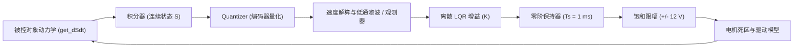

# Sim-to-Real 仿真离散化与非理想特性建模

理想连续时间仿真假设传感器具有无限分辨率、执行器响应无延迟且无静摩擦死区。为了使 Simulink 仿真与 1 kHz STM32F446RE 实物平台保持一致，需要在仿真模型（`simulation/lqr_first_order_filter/`）中引入以下四类非理想特性。

---

## 1. 时间离散化：零阶保持器（Zero-Order Hold, ZOH）

- **物理成因**：嵌入式控制周期为 $1\text{ kHz}$（$T_s = 0.001\text{ s}$）。在一个采样周期内，PWM 电机控制指令保持恒定。
- **Simulink 实现**：在控制器输出与被控对象/电机输入之间插入 `Zero-Order Hold` 模块，设置 `Sample time = 0.001`。
- **控制器对应设计**：在 MATLAB 中通过 `c2d(sys_c, T_s, 'zoh')` 对机电联合连续模型进行离散化，并使用 `dlqr(G, H, Q, R)` 求解离散最优反馈增益。

---

## 2. 角度空间量化：Quantizer 模块

- **物理成因**：正交编码器只能输出离散脉冲计数，而非连续角度。
- **硬件分辨率（STM32 定时器 4 倍频正交解码）**：
  - **摆杆编码器（`TIM3`）**：$4096\text{ counts/rev} \implies \Delta\theta_1 = \frac{2\pi}{4096} \approx 1.534 \times 10^{-3}\text{ rad}$
  - **旋臂电机编码器（`TIM1`）**：电机轴 $44\text{ counts/rev} \times 9.267$（减速比）$\approx 407.75\text{ counts/rev}$（输出轴）$\implies \Delta\theta_{\text{arm}} = \frac{2\pi}{44 \times 9.267} \approx 1.541 \times 10^{-2}\text{ rad}$
- **Simulink 实现**：使用 `Demux` 拆出状态向量 $S = [\theta_{\text{arm}},\, \dot{\theta}_{\text{arm}},\, \theta_1,\, \dot{\theta}_1]^T$，仅对两个角度通道（$\theta_{\text{arm}}$ 和 $\theta_1$）施加对应步长的 `Quantizer`。角速度通道不应直接量化，而应由量化后的角度经差分滤波或观测器解算获得。

---

## 3. 差分速度噪声与滤波

- **物理成因**：编码器不直接测量角速度。在 $T_s = 1\text{ ms}$ 下直接后向差分会把单格跳变放大为剧烈尖峰（如摆杆单步跳变对应 $\Delta\theta_1 / T_s \approx 1.53\text{ rad/s}$），未跳变周期则为 $0$。
- **Simulink 实现**：基于量化角度做离散差分并接入一阶低通滤波器，或采用离散状态观测器估计速度（详见 [lqr_filter_CN.md](lqr_filter_CN.md)）。

---

## 4. 执行器饱和与电机死区

- **物理成因**：
  - **饱和（Saturation）**：供电上限为 $\pm 12\text{ V}$（固件中进一步设置了 `PWM_DUTY_SAFETY_CAP = 0.80`）。
  - **死区（Dead Zone）**：当指令力矩/电压低于静摩擦阈值时，电机无法克服静阻力矩转动。
- **Simulink 实现**：在电机/被控对象输入前串联 `Saturation` 与 `Dead Zone` 模块，以在仿真中复现实物平台直立稳态下的极限环（Limit Cycle）微幅振荡。

---

## 高保真闭环仿真拓扑

## 推荐分步验证顺序

1. 先加入 **Saturation**，验证输入受限条件下的基本稳定性。
2. 加入 **Zero-Order Hold**（$T_s = 1\text{ ms}$），并将设计方法从 `lqr` 切换为 `dlqr`。
3. 加入 **Quantizer + 速度滤波/观测器**，权衡噪声抑制与相位延迟。
4. 最后加入 **Dead Zone** 与实测摩擦参数，对齐实物平台的稳态极限环特征。
