# furuta-inverted-pendulum
TODO: Include documentation for double pendulum

## Repo Structure
**Main Dynamics Code** (No need to download for control): 
1. furuta_single_inverted_pendulum_live.mlx
2. furuta_single_inverted_pendulum_nonlive_copy.m

**Basic Simulation** (Can be downloaded or you can make your own):
[furuta_single_inverted_pendulum_model.slx](#simulinkModel)

**Dynamics Functions** (in functions folder): 
1. [furuta_single_A_B_matrices.m](#AB) (specifically for LQR)
2. [furuta_single_state_derivative.m](#state_derivative)

**Animation Function/Script** (in functions folder): 
1. [realtime_animation.m](#realtime_animation)
2. [playback_animation.m](#playback_animation)

## How to Download

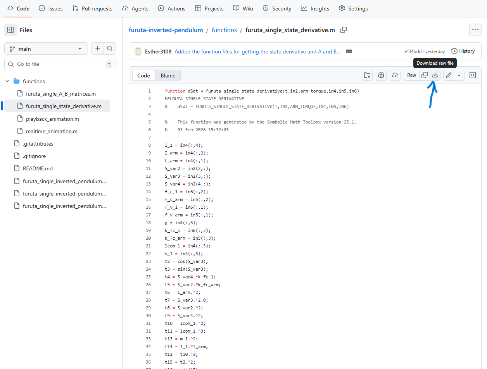

<a name="simulinkModel"></a>
## Simulation Model
The **get_dSdt** MATLAB Function block contains the function [here](#get_dSdt).

Make sure to set the parameter sizes correctly for the animation code to run properly:

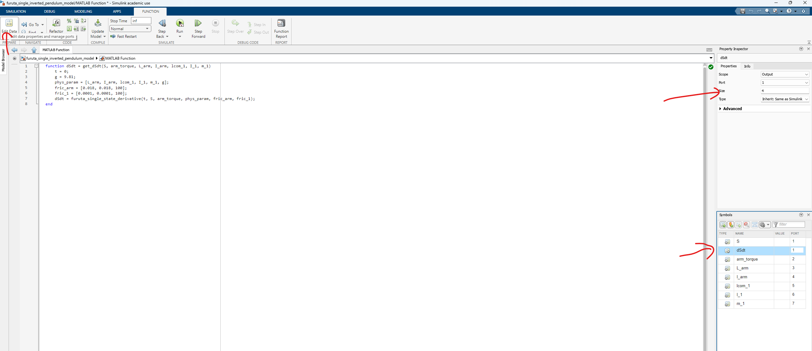

The **animation** MATLAB Function block contains the function [here](#realtime_animation).

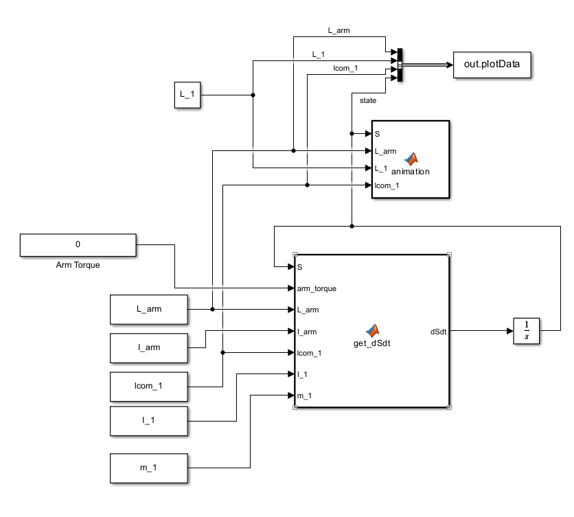

The initial conditions are defined in the integrator block:

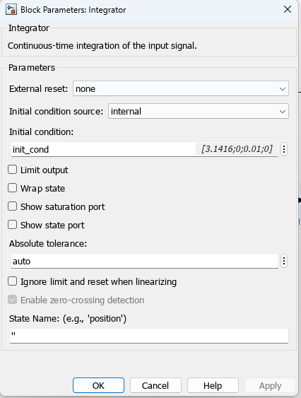


The **out.plotData** is a **To Workspace** block outputting the **S**, **L_arm**, **L_1** and **lcom_1** to workspace, which can then be plotted using playback_animation.m script explained [here](#playback_animation)

The parameters have been defined in the model workspace:

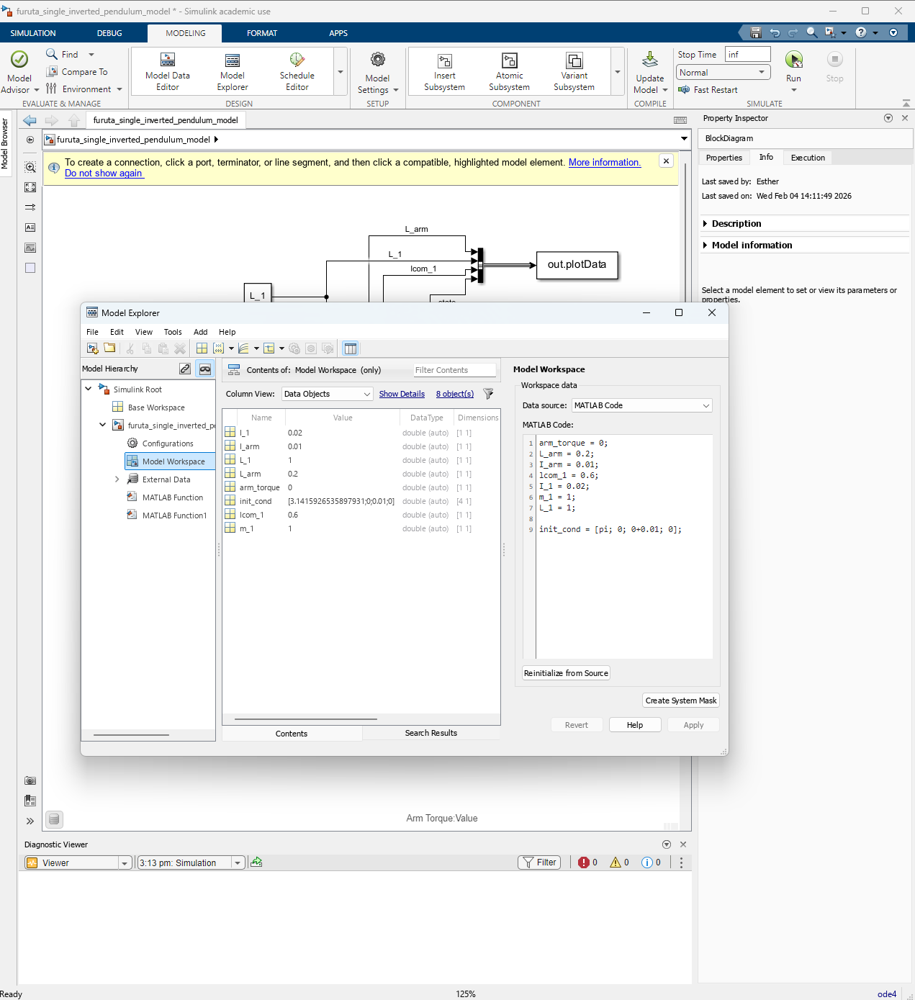

Set the simulation pacing from the dropdown from the Run button to slow down the simulation:

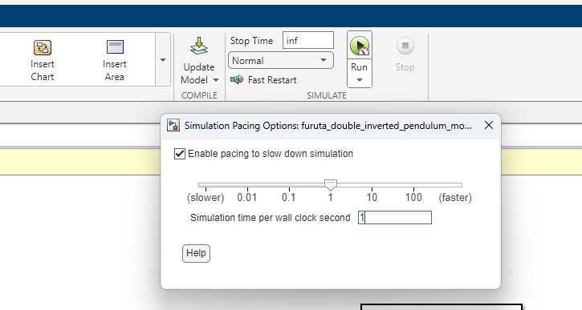

If your functions are in a different folder from the Simulink model, you can add path to the functions folder in the InitFcn, which runs every time a model is initialised (or use your own preferred method):

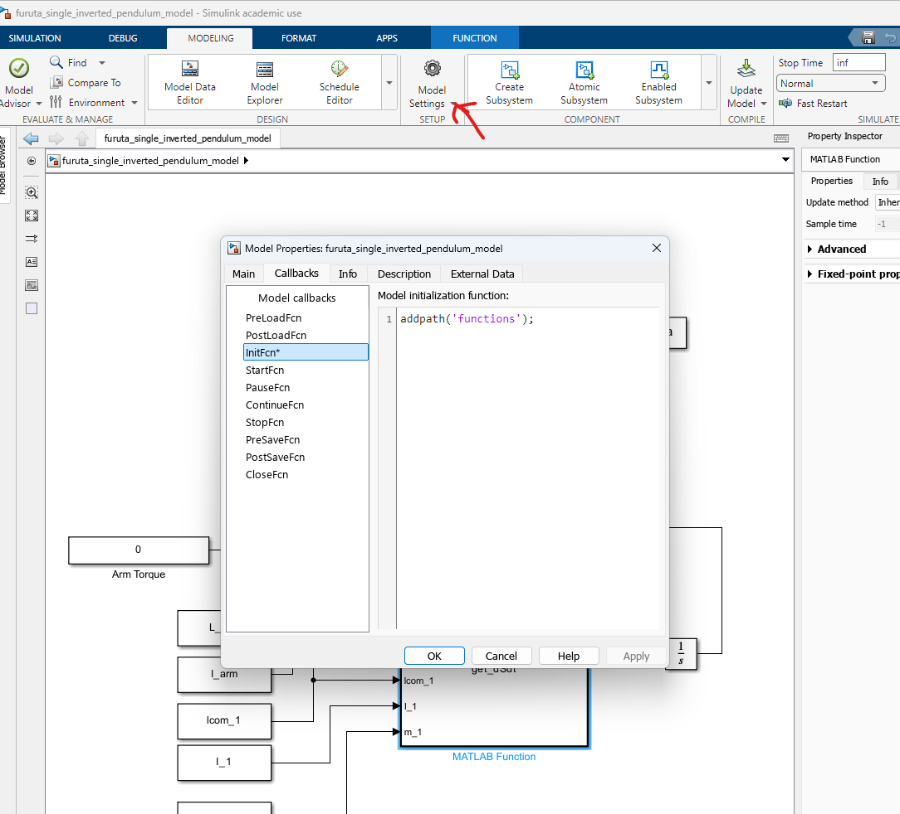

<a name="state_derivative"></a>
## furuta_single_state_derivative.m
This file contains a function that outputs the state derivative given inputs: t, S, arm_torque, phys_param, fric_arm, fric_1. ([see Parameter Mapping Table](#parameter) and [A Note on t](#t) for details on how the parameters are defined.

After downloading the file, the function can be called directly in MATLAB Function block or a MATLAB script using this signature:

```matlab
% Function Signature
dSdt = furuta_single_state_derivative(t, S, arm_torque, phys_param, fric_arm, fric_1);
```

The state $S$ is a minimal set of variables that fully describes the system at any time and contains all information needed to predict its future behavior.

The state for a furuta single pendulum includes the arm angle, arm angular velocity, pendulum angle and pendulum angular velocity.

See this video for details: https://youtu.be/hpeKrMG-WP0?si=5h9RH9bMr9z2cLGj

<a name="get_dSdt"></a>
```matlab
% Example Function Call used in Simulink MATLAB Function block (The numbers below are random and for demo only)
function dSdt = get_dSdt(S, arm_torque, L_arm, I_arm, lcom_1, I_1, m_1)
    t = 0;
    g = 9.81;
    phys_param = [L_arm, I_arm, lcom_1, I_1, m_1, g];
    fric_arm = [0.018, 0.018, 100];
    fric_1 = [0.0001, 0.0001, 100];
    dSdt = furuta_single_state_derivative(t, S, arm_torque, phys_param, fric_arm, fric_1);
end
```
Given the state at the previous timestep, integrating the state derivative ($\frac{dS}{dt}$) gives the state at the next timestep. 

Example with Euler Method (ode1):

$$ S_{next} = S_{previous} + \frac{dS}{dt} \cdot \Delta t$$

<a name="AB"></a>
## furuta_single_A_B_matrices.m
This file contains a function that outputs the $A$ and $B$ matrices required for LQR ([see Parameter Mapping Table](#parameter) and [A Note on t](#t) for details on how the parameters are defined.

After downloading the file, the function can be called directly in MATLAB Function block or a MATLAB script using this signature:
```matlab
% Function Signature
[A, B] = furuta_single_A_B_matrices(t, phys_param, fric_arm, fric_1);
% The output A is a 4x4 matrix and B is a 4x1 matrix
```
Standard state-space equation:

$$\dot{x} = Ax + Bu$$

Where $x$ is the state ($S$), $\dot{x}$ is the state derivative ($\frac{dS}{dt}$), $u$ is the input (arm_torque).

The $A$ and $B$ matrices output from the function have been linearised around the upright position (the angles and angular velocities for both the arm and pendulum are 0).

<a name="realtime_animation"></a>
## realtime_animation.m
This file contains a function that is used to plot the pendulum in real-time when the simulation is running. It can be used in a MATLAB Function block as shown [here](#simulinkModel).

The meanings of the parameters are explained [here](#parameter).

After downloading the file, the function can be called directly in MATLAB Function block or a MATLAB script in this way:
```matlab
% Example Function Call used in Simulink MATLAB Function block (The numbers below are random and for demo only)
function animation(S, L_arm, L_1, lcom_1)
    update_ratio = 100;
    realtime_animation(S, L_arm, L_1, lcom_1, update_ratio);
end
```
The **update_ratio** variable determines how often the plot is updated. For example, if update_ratio is 100, the plot updates once every 100 function calls to the MATLAB Function block.

The function should produce a plot that looks like this:
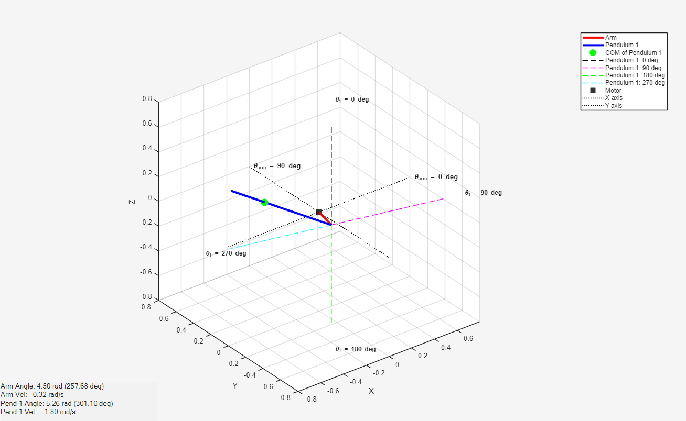

<a name="playback_animation"></a>
## playback_animation.m
This file contains the script used to plot an animation using the data gathered from simulation. 

The simulation data comes from the **To Workspace** block in simulation as shown [here](#simulinkModel).

This script assumes the **To Workspace** block is named **plotData** and contains **S**, **L_arm**, **L_1** and **lcom_1**.
The meanings of the parameters are explained [here](#parameter)

Running the script should produce a plot that looks like this:

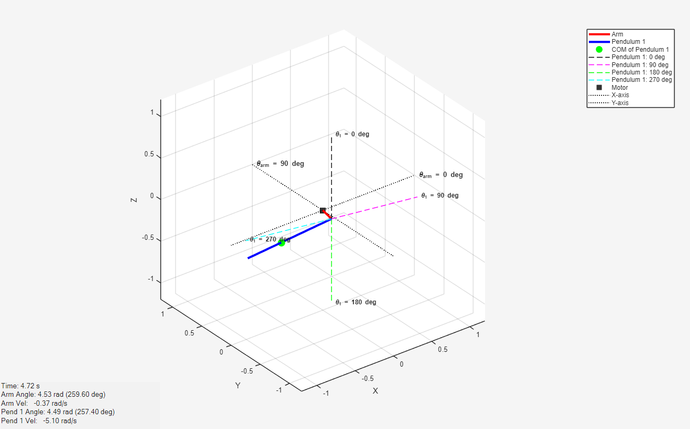

<a name="t"></a>
## A Note on t
The time variable t is required by MATLAB's ODE solvers. Since our pendulum model is time-invariant (the physics don't change at $t=5s$ vs $t=0s$), you can pass any value (like 0) as t.

<a name="parameter"></a>
## Parameter Mapping Table

| Array | Index | Parameter | Symbol | Unit | Note |
| :--- | :--- | :--- | :--- | :--- | :--- |
| **S** (States) | 1 | Arm Angle | $\theta_{arm}$ | $rad$ | 
| Size: 4x1| 2 | Arm Velocity | $\dot{\theta}_{arm}$ | $rads^{-1}$ | 
| | 3 | Pendulum Angle | $\theta_1$ |$rad$ | $=0$ when upright, $=pi$ when hanging down
| | 4 | Pendulum Velocity | $\dot{\theta}_1$ | $rads^{-1}$ | 
| **dSdt** (State derivative) | 1 | Arm Velocity | $\dot{\theta}_{arm}$ | $rads^{-1}$ | 
| Size: 4x1| 2 | Arm Acceleration | $\ddot{\theta}_{arm}$ | $rads^{-2}$ | 
| | 3 | Pendulum Velocity | $\dot{\theta}_1$ | $rads^{-1}$ | 
| | 4 | Pendulum Acceleration | $\ddot{\theta}_1$ | $rads^{-2}$ | 
| **phys_param** | 1 | Arm Length | $L_{arm}$ | $m$ | 
| Size: 1x6 | 2 | Moment of Inertia of the Arm | $I_{arm}$ | $kgm^2$ | 
| | 3 | Distance between the arm-connected end of the pendulum and its center of mass | $lcom_1$ | $m$ | 
| | 4 | Moment of Inertia of the Pendulum | $I_1$ | $kgm^2$ | 
| | 5 | Pendulum Mass | $m_1$ | $kg$ | 
| | 6 | Gravity | $g$ | $ms^{-2}$ | $=9.81$
| **fric_arm** | 1 | Viscous Damping Coefficient of the Arm | $f_{v_{arm}}$ | $Nms/rad$ | [see friction modelling](#friction)
| Size: 1x3 | 2 | Coulomb Friction Torque of the Arm | $f_{c_{arm}}$ | $Nm$ | [see friction modelling](#friction)
| | 3 | Coulomb Friction Smoothing Gain for the Arm | $k_{fc_{arm}}$ | $s/rad$ |[see friction modelling](#friction)
| **fric_1** | 1 | Viscous Damping Coefficient of the Pendulum | $f_{v_{1}}$ | $Nms/rad$ | [see friction modelling](#friction)
| Size: 1x3 | 2 | Coulomb Friction Torque of the Pendulum | $f_{c_{1}}$ | $Nm$ | [see friction modelling](#friction)
| | 3 | Coulomb Friction Smoothing Gain for the Pendulum | $k_{fc_{1}}$ | $s/rad$ | [see friction modelling](#friction)

**L_1** is the length of the pendulum in $m$. It is used for plotting animation but is not required in the dynamics calculations.

<a name="friction"></a>
## Friction Modelling
The system accounts for two types of friction acting on both the horizontal arm and the pendulum: Viscous Damping and Coulomb Friction.
1. Viscous friction is proportional to the angular velocity of the joint. It represents the resistance caused by lubricants and air.

$$\tau_{viscous} = f_v \cdot \dot{\theta}$$

2. Standard Coulomb friction depends only on the direction of motion:

$$\tau_{coulomb} = f_c \cdot \text{sign}(\dot{\theta})$$

However, the $\text{sign}$ function is discontinuous at $\dot{\theta} = 0$, which can cause numerical instability and slow down the MATLAB solver. To fix this, a continuous approximation using the hyperbolic tangent function:

$$\tau_{coulomb} \approx f_c \cdot \tanh(k \cdot \dot{\theta})$$

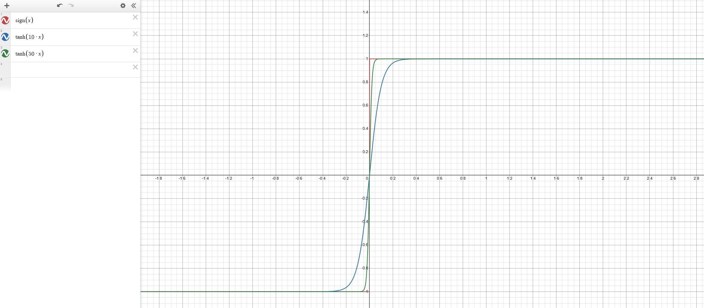

***Question: Is it reasonable to stick with this simple model for now and only use more complicated friction models if we find that this model cannot fit our physical rig well enough?***

<a name="angle"></a>
## Angle Convention
The system is a loop where the previous state is used to find the next state using the dS/dt obtained from EOM. The angles in the newly obtained state S_next, when it gets passed back to the get_dSdt function as 'S_previous', should not be wrapped but instead be continuous. Otherwise, there would be a large change in the angle values in a short time, introducing a close to infinite rate of angle change.

https://engineerfix.com/what-is-phase-wrapping-and-how-is-it-unwrapped/

Therefore, the angles in the state vector should +360 deg when it goes round a full circle (e.g. rotating the pendulum angle from 355 deg by 10 deg will result in 365 deg, rather than 5 deg).

However, angle wrapping is used in the animation code to display data in a more understandable way. This does not affect the state calculations.

<a name="EOM"></a>
## EOM Derivation

This is how the x and y positions of the single pendulum were derived:

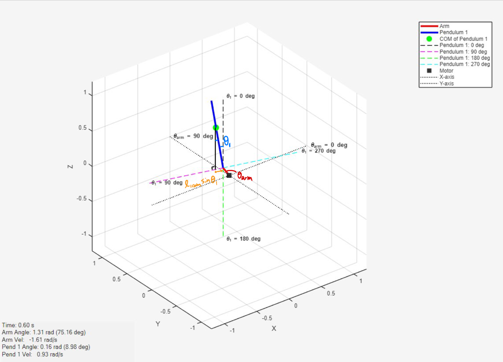

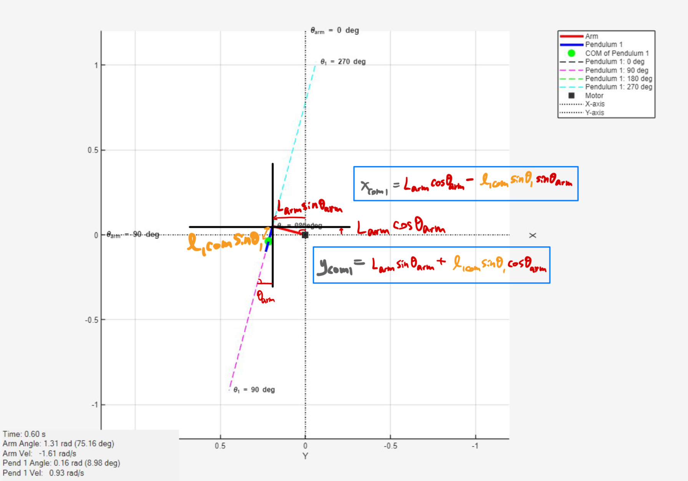

Please see the furuta_single_inverted_pendulum_live.mlx code for more details.

<a name="ode_solver"></a>
## ODE Solver

My understanding is that a more accurate solver should be used to most accurately resemble the physical system, so that any controller gains verified in simulation should work well on the physical rig. 

This is the state data when using **ode4** solver with a fixed $0.001 s$ step size for the **double pendulum**:

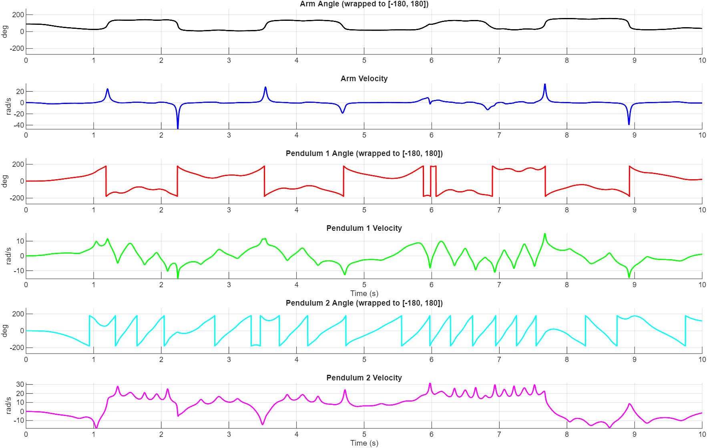

And this is the state data when using **ode1** solver with a fixed $0.001 s$ step size while keeping everything else the same:

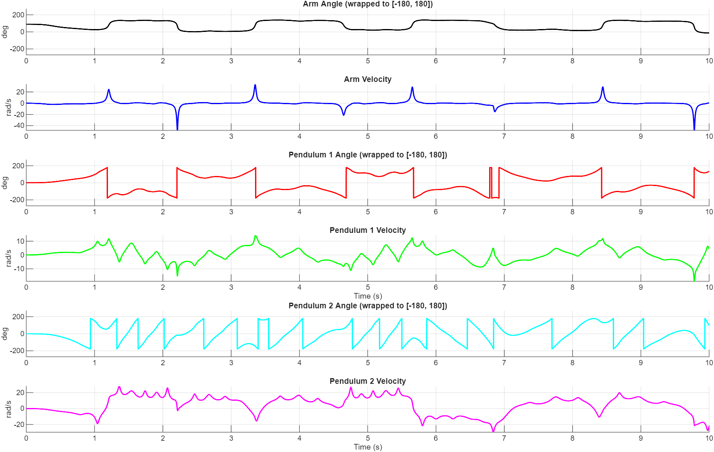

These are the solver options for fixed step. Which solver should I use?

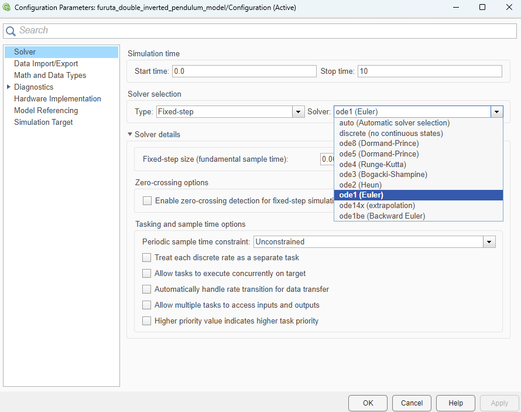

